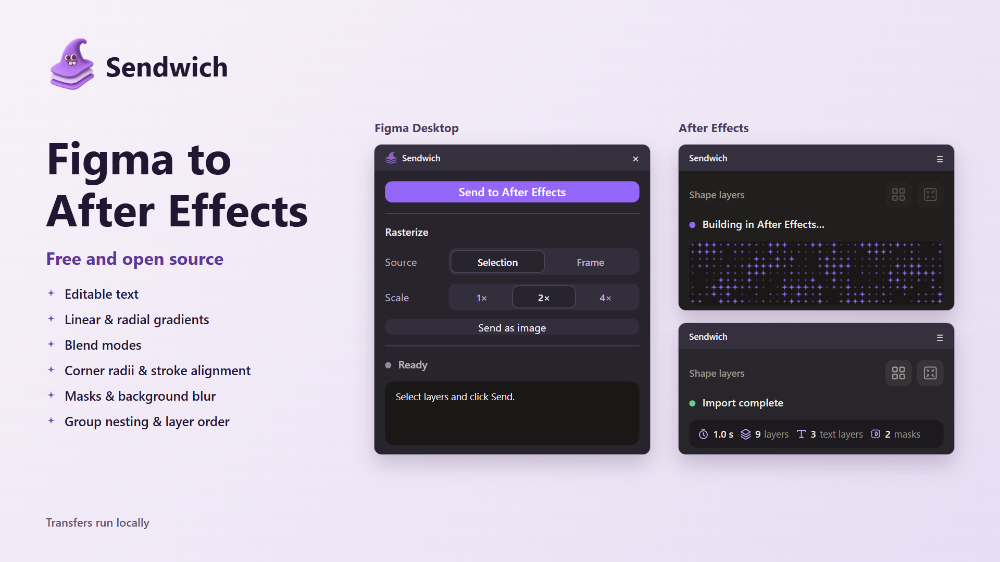

# Sendwich

Sendwich sends selected artwork from Figma or Illustrator to After Effects on the same computer. Vectors become editable shape layers, text becomes text layers, and raster artwork is imported as images. Supported features include gradients, alpha mattes and some effects.

## Download and install

| Download | What it installs |
| --- | --- |
| [Sendwich.zxp](https://github.com/saniochk/Sendwich/releases/download/v0.34.4/Sendwich.zxp?build=6ea088325efd) | Both After Effects and Illustrator panels |
| [Figma plugin ZIP](https://github.com/saniochk/Sendwich/releases/download/v0.34.4/Sendwich-0.34.4-Figma.zip) | Figma plugin, including `SendwichFigma/manifest.json` |

[Installation guide in Russian](INSTALL-ZXP-RU.md). [SHA-256 checksums](https://github.com/saniochk/Sendwich/releases/download/v0.34.4/SHA256SUMS.txt?build=6ea088325efd). Declared Adobe versions: After Effects 22+ and Illustrator 25+.

### After Effects and Illustrator

1. Save your work and close both Adobe applications.
2. Open [aescripts ZXP/UXP Installer](https://aescripts.com/learn/post/zxp-installer) and drag `Sendwich.zxp` into its window.
3. If it says **No application compatible with Sendwich was found on your computer**, choose **Install** or **Install Anyway**. This compatibility notice did not prevent installation in our Windows test; Creative Cloud sign-in was not required for that installation. Signature verification failures and installation errors need to be resolved separately.
4. Restart the Adobe applications and open **Window → Extensions → Sendwich** in each. Keep the After Effects panel open while sending.

Windows installation and the hat icon in ZXP Installer have been confirmed. Installation of this combined ZXP on macOS has not yet been verified. The signed CEP panels do not require PlayerDebugMode. See the [code signing policy](RELEASE.md#code-signing-policy).

### Figma Desktop

1. Download the **Figma plugin ZIP** above and extract the entire archive to a permanent folder of your choice.
2. In Figma Desktop, open a design file and choose **Plugins → Development → Import plugin from manifest…**.
3. Select **`SendwichFigma/manifest.json`** in the extracted folder. Keep `manifest.json`, `code.js` and `ui.html` together; the manifest alone is not the plugin.
4. Keep the extracted folder: Figma loads the development plugin from that location.
## Connect Figma

1. Run the Sendwich development plugin installed from the Figma ZIP above.
2. Open Sendwich in After Effects. In Figma, run Sendwich and click **Connect to After Effects**.
3. Check that both panels show the same short code and click **Allow** in After Effects. Sendwich remembers the connection.
4. Select a layer or frame and click **Send to After Effects**. If you use Figma in a browser after publication, it may need permission to access the local network.

Use **Send as image** to flatten artwork to PNG. Import goes into the active composition, or a new composition based on the source dimensions. In After Effects, **Explode** separates shape groups into layers and **Merge** combines compatible shape layers.

Figma frame clipping is ignored. Explicit mask layers are imported as track mattes. Source group nesting is kept in Shape Layer Contents. Text, raster images, explicit track mattes and layer effects may require separate timeline layers. Inside/outside strokes are editable outlines. Background blur uses a Gaussian Blur adjustment layer with a separate alpha matte. Inner shadows remain unsupported. Mixed text styles need AE 24.3+. The local transfer of a single Figma clip is limited to 128 MiB including encoded images.

## Uninstall

Remove the Adobe panels using ZXP/UXP Installer. In Figma, remove Sendwich from **Plugins → Development**. After removing that entry, you can delete its extracted plugin folder if you no longer need it.
## Development

- [Release build and verification](RELEASE.md)
- [Figma Community submission checklist](FigmaCommunity/CHECKLIST_RU.md)
- [Privacy policy](FigmaCommunity/PRIVACY.md)

MIT License. Copyright 2026 Saniochk. See [third-party notices](THIRD_PARTY_NOTICES.txt). Sendwich is independently developed.
